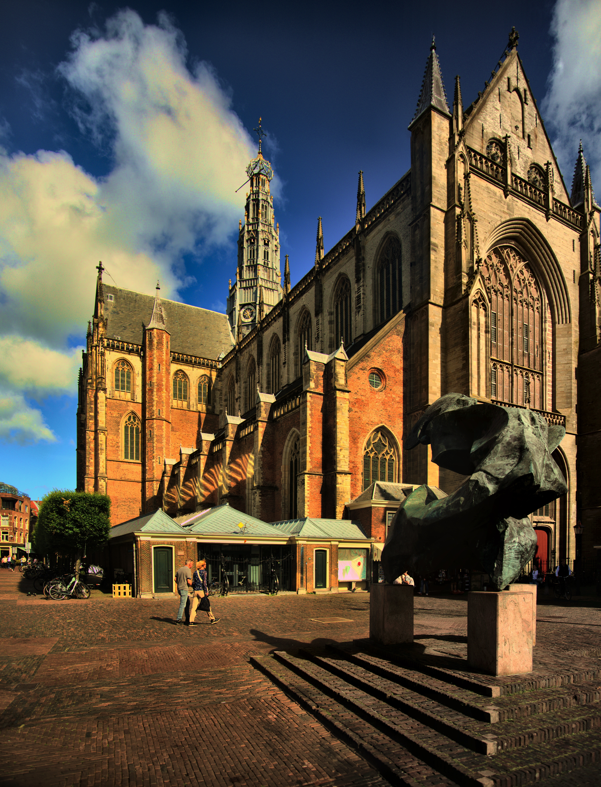
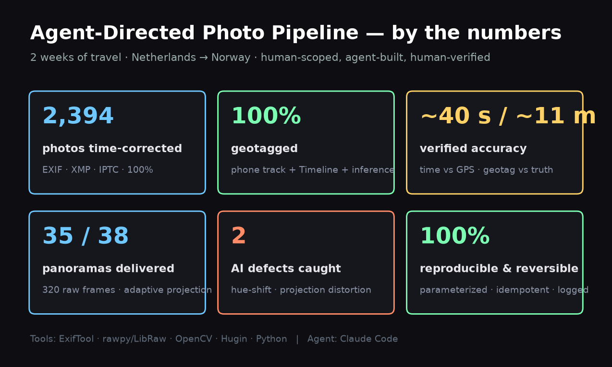
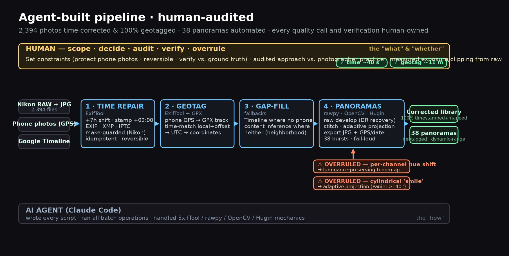
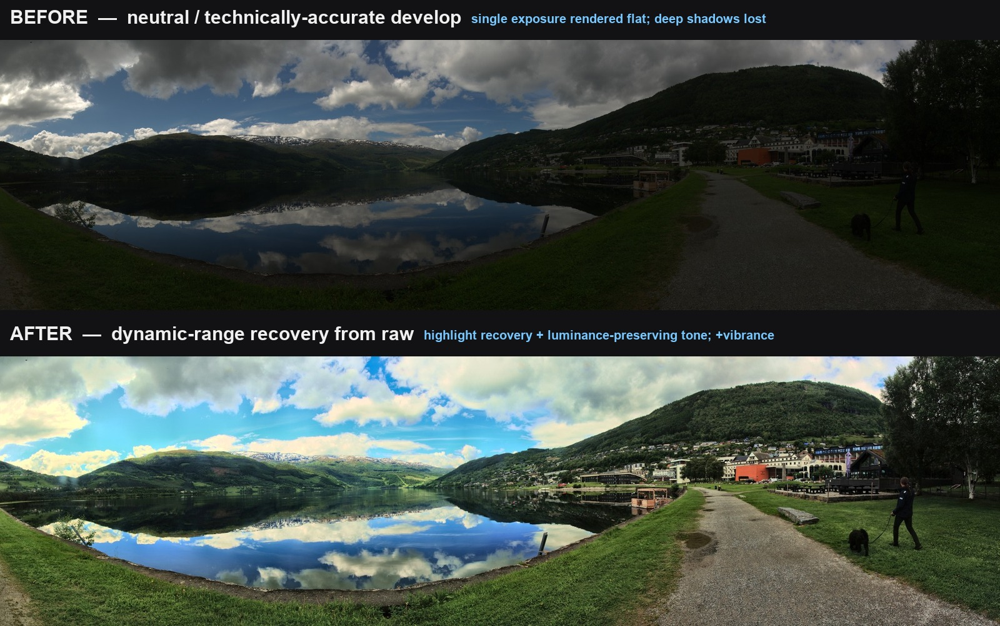
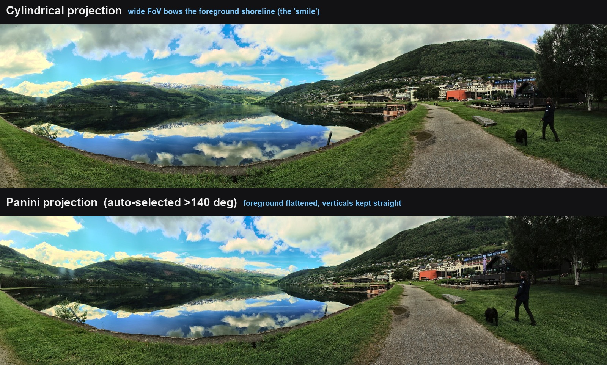
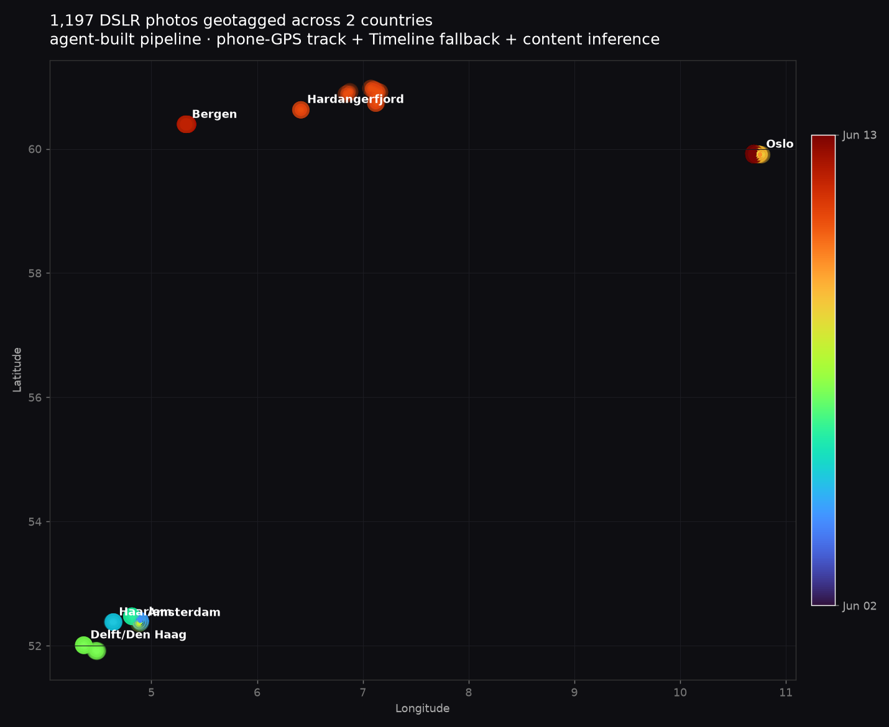
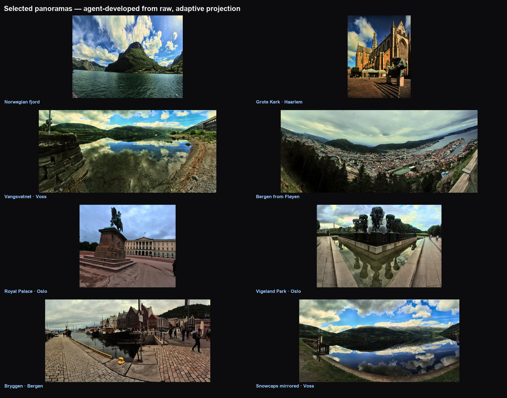

# DSLR Metadata Repair & Panorama Automation

A reproducible pipeline — **built by directing an AI coding agent and auditing its work** — that repaired the timestamps and GPS on **2,394 travel photos** and batch-stitched **38 panoramas** from raw.

> The point of this project isn't the photos. It's a documented example of **working effectively with AI**: scoping a messy real problem, delegating the mechanics to an agent, and keeping human ownership of the quality decisions and verification. → **[Full case study](CASE_STUDY.md)** · **[Reflection: what I owned vs. the agent](REFLECTION.md)**



---

## By the numbers


## How it works


| Stage | Tool | What happens |
|---|---|---|
| **1 · Time repair** | ExifTool | Shift every capture timestamp (EXIF + XMP + IPTC) and stamp the true timezone. Guarded to one camera make; idempotent; reversible; keeps backups. |
| **2 · Geotag** | ExifTool | Build a GPX track from phone-photo GPS, then time-match it to the DSLR photos (local time + offset → UTC). |
| **3 · Gap-fill** | ExifTool | Google Timeline fallback where the phone had no signal; content-inference stamps where neither existed. |
| **4 · Panoramas** | rawpy · OpenCV · Hugin | Per burst: raw develop with dynamic-range recovery → Hugin stitch with **adaptive projection** → JPG with GPS + date. |

## Two decisions I overruled the agent on
**Dynamic-range recovery** — its first tone-map shifted hue in bright skies; I switched it to luminance-preserving tone-mapping:


**Adaptive projection** — its default bowed the foreground; projection is now chosen per scene from the measured field of view:


## Results
**1,197 DSLR photos geotagged across two countries** (verified to ~11 m):


**Selected panoramas** (developed from raw, adaptive projection):


---

## Scripts
- **`fix_dslr_time.bat`** — timezone/timestamp repair. Parameterized (`SHIFT`, `OFFSET`, `MATCH`, `FOLDER`, `BACKUP`).
- **`build_gpx_and_geotag.bat`** + **`gpx.fmt`** — phone-GPS → GPX, then geotag the DSLR files; supports a fallback track.
- **`pano_batch.py`** — the panorama batch builder (auto-detects bursts, develops from raw, stitches, exports; retries transient I/O; flags low-texture bursts for manual finishing).
- **`assess_exposure.py`** / **`assess_clipping.py`** — the "measure, don't guess" triage: rank every burst by exposure spread and raw clipping *before* processing.

## Requirements
- [ExifTool](https://exiftool.org) on `PATH` · [Hugin](https://hugin.sourceforge.io) CLI tools
- Python 3.10+ with `rawpy opencv-python imageio tifffile numpy pillow matplotlib`

## Usage
```bash
fix_dslr_time.bat                 # 1) repair timestamps (edit the SET block first)
build_gpx_and_geotag.bat          # 2) build GPS track + geotag
python pano_batch.py --list       # 3a) preview detected panorama bursts
python pano_batch.py              # 3b) stitch all -> JPGs with GPS + date
```

---
*Built 2026. Coding by an AI agent (Claude Code); problem scoping, quality decisions, auditing, and verification by a human.*
